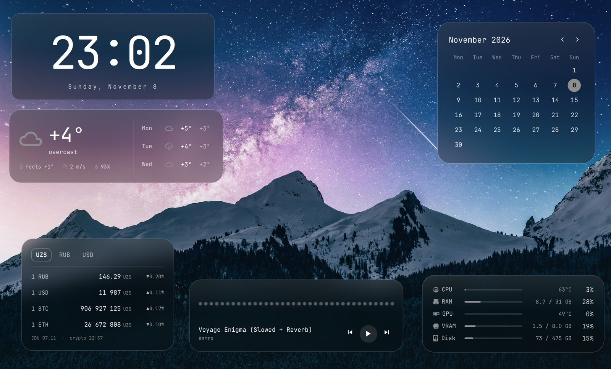

# omagadgets

**English** · [Русский](README.ru.md)

Glass desktop gadgets for [Omarchy](https://omarchy.org/): clock, weather,
hardware, now playing and calendar cards that live on one workspace of your
choice and stay out of the way everywhere else.



The cards sit on the desktop layer, above the wallpaper and below your windows.
They only appear while the `home` workspace (configurable) is active on a
monitor, so the rest of your workspaces stay clean. Drag and resize them in edit
mode; the layout is remembered. Show all five gadgets or only the ones you want.

## Gadgets

| Card | Shows |
|---|---|
| **Clock** | Large time and the full date. |
| **Weather** | Current temperature, conditions, feels-like, wind and humidity, plus a three-day forecast. Data from [Open-Meteo](https://open-meteo.com/) (no API key), refreshed at most every 15 minutes, for the location set in Omarchy's weather settings. |
| **Hardware** | CPU load and temperature, RAM, GPU load and temperature, VRAM, and disk usage of `/`. |
| **Now playing** | Track and artist from any MPRIS player, previous / play-pause / next buttons, and a live audio visualizer. |
| **Calendar** | The current month with today highlighted. Page with ‹ ›; click the month title to jump back. |

## Features

- **Follows your theme:** colours and font come from the active Omarchy theme.
- **Frosted glass** with Hyprland blur (see below).
- **Edit mode:** drag cards anywhere, resize from the corner handle, double-click
  to put a card back. Positions snap to a fine grid and to the vertical centre line.
- **Pick your gadgets:** turn each one on or off in `shell.json`; a gadget that is
  off is not loaded at all.
- **One workspace only:** shown on every monitor whose active workspace is `home`
  (or the one you set).
- **Click-through:** only the media buttons and calendar arrows take clicks;
  everything else passes through to the desktop.
- **Battery-friendly:** nothing polls while the cards are hidden, and a
  runtime-suspended NVIDIA GPU is not woken up (it reads "sleep").

## Requirements

- Omarchy with `omarchy-shell`, on Hyprland.
- `curl` for the weather and `cava` for the visualizer:
  ```bash
  omarchy pkg add cava
  ```
- A named workspace `home` to show the cards on (see [Setup](#setup)).

### Hardware support

The hardware card currently reads:

- **CPU temperature** from Intel's `coretemp` sensor.
- **GPU** from an NVIDIA card via `nvidia-smi`.

On other hardware those rows show `—`; CPU load, RAM and disk work everywhere.
AMD support is planned.

## Installation

```bash
omarchy plugin add https://github.com/miruken1207/omagadgets.git --enable
```

Like any third-party plugin, it runs as unsandboxed code inside `omarchy-shell`.
Read the code before enabling it.

Or manually:

```bash
git clone https://github.com/miruken1207/omagadgets.git ~/.config/omarchy/plugins/miruken1207.omagadgets
omarchy plugin enable miruken1207.omagadgets
```

## Setup

### 1. A home workspace

The cards appear on the workspace named `home`. Add a key to go there in
`~/.config/hypr/bindings.lua`:

```lua
o.bind("SUPER + grave", "Home workspace", hl.dsp.focus({ workspace = "name:home" }))
```

Hyprland creates the workspace the first time you focus it.

### 2. Glass effect

The frosting is Hyprland's blur. Omarchy ships with blur off, so turn it on and
apply it to the gadgets layer in `~/.config/hypr/looknfeel.lua`:

```lua
hl.config({ decoration = { blur = { enabled = true, size = 10, passes = 3, noise = 0.02 } } })
hl.layer_rule({ match = { namespace = "^miruken1207-omagadgets$" }, blur = true, ignore_alpha = 0.1 })
```

`ignore_alpha` keeps the blur to the cards themselves.

### 3. Edit mode key

Edit mode is toggled by a script that ships with the plugin:

```lua
o.bind("SUPER + ALT + grave", "Edit omagadgets",
  os.getenv("HOME") .. "/.config/omarchy/plugins/miruken1207.omagadgets/omagadgets-edit")
```

Turning edit mode on jumps to the gadgets' workspace. Press the key again, or
the **Done** button at the top of the screen, to finish.

## Configuration

Settings live inline on the plugin's entry in `~/.config/omarchy/shell.json` and
apply as soon as you save:

```json
{
  "plugins": [
    {
      "id": "miruken1207.omagadgets",
      "gadgets": ["clock", "weather", "calendar"],
      "workspace": "home"
    }
  ]
}
```

| Key | Default | Description |
|---|---|---|
| `gadgets` | all five | Which gadgets to show: any of `"clock"`, `"weather"`, `"hardware"`, `"media"`, `"calendar"`. Order doesn't matter; unknown names are ignored. `[]` hides them all. |
| `workspace` | `"home"` | Name of the workspace the gadgets appear on. |

## Files

| Path | What |
|---|---|
| `~/.config/omarchy/omagadgets.json` | Card positions and sizes by gadget (`{ "clock": { "x": 0.5, "y": 0.2, "scale": 1 }, … }`), written by edit mode. Delete it to reset the layout. |
| `~/.local/state/omagadgets/editing` | Edit mode flag (`1` / `0`). |

## Project structure

Each gadget is self-contained: it fetches its own data, draws itself, and
imports nothing but `kit/`.

```
Service.qml          reads settings, owns the layout, opens a window per monitor
GadgetsWindow.qml    the layer surface: edit banner, click mask, a slot per gadget
Settings.js          settings parsing (pure)
kit/
  GlassCard.qml      the frosted card every gadget is drawn on
  CardSlot.qml       placement, dragging and resizing in edit mode
  EditBanner.qml     the hint and Done button
  LayoutStore.qml    omagadgets.json and the edit mode flag
gadgets/
  clock/             Clock.qml
  weather/           Weather.qml, WeatherModel.js
  hardware/          Hardware.qml, Meter.qml, HardwareModel.js
  media/             Media.qml
  calendar/          Calendar.qml, CalendarModel.js
tests/               node tests for the pure logic
omagadgets-edit      edit mode toggle script
```

A gadget is a `gadgets/<id>/<Id>.qml` component. The window gives it `host`
(`u`, one hundredth of the screen height; `active`, true while it is on screen;
`editing`; `options`, its settings) and reads back `defaultX` / `defaultY`
(where it sits before the user moves it, as fractions of the screen) and
`clickArea` (the item that takes clicks outside edit mode, or `null`). Adding a
gadget means adding its folder, its id in `Settings.js`, and an import and a
slot in `GadgetsWindow.qml`. The import is needed because Quickshell only
registers QML types in directories it reaches through `import` statements.

## Development

Run the tests for the pure logic (settings, weather, hardware parsing, calendar):

```bash
node tests/model.test.js
```

The shell keeps compiled QML in memory, so after editing the plugin's files run
`omarchy restart shell`. Disabling and enabling the plugin is not enough.

## License

[MIT](LICENSE) © Mirzabek Rakhimov
