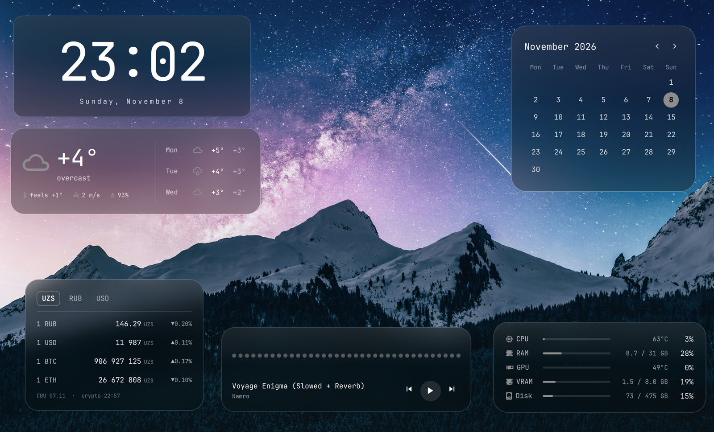

# omagadgets

[English](README.md) · **Русский**

Стеклянные гаджеты рабочего стола для [Omarchy](https://omarchy.org/): часы,
погода, железо, текущий трек, календарь и курсы валют. Карточки живут на одном выбранном
воркспейсе и не мешают на остальных.



Карточки рисуются на слое рабочего стола: над обоями и под окнами. Они
появляются, только когда на мониторе активен воркспейс `home` (его можно
поменять), так что остальные воркспейсы остаются чистыми. В режиме
редактирования карточки можно двигать и масштабировать, раскладка запоминается.
Можно показывать все шесть гаджетов или только нужные.

## Гаджеты

| Карточка | Что показывает |
|---|---|
| **Часы** | Крупное время и полная дата. |
| **Погода** | Текущая температура, состояние, «ощущается как», ветер и влажность, плюс прогноз на три дня. Данные от [Open-Meteo](https://open-meteo.com/) (без API-ключа), обновляются не чаще раза в 15 минут, для места из настроек погоды Omarchy. |
| **Железо** | Загрузка и температура CPU, RAM, загрузка и температура GPU, VRAM и занятое место на `/`. |
| **Сейчас играет** | Трек и исполнитель из любого MPRIS-плеера, кнопки назад / пауза / вперёд и живой аудиовизуализатор. |
| **Календарь** | Текущий месяц с выделенным сегодняшним днём. Листается стрелками ‹ ›, клик по названию месяца возвращает к текущему. |
| **Курсы** | Цены валют и криптовалют в валюте выбранной вкладки (по умолчанию UZS / RUB / USD) с изменением за сутки. Фиат от [Центробанка Узбекистана](https://cbu.uz/) (официальные курсы, обновляются раз в 3 часа, кросс-курсы через сум), крипта от [CoinGecko](https://www.coingecko.com/) (раз в 5 минут). Мелкие курсы показываются за 1 000 или 100 000 единиц, чтобы оставаться читаемыми. |

## Возможности

- **Следует теме:** цвета и шрифт берутся из активной темы Omarchy.
- **Матовое стекло** на блюре Hyprland (см. ниже).
- **Режим редактирования:** перетаскивайте карточки, меняйте размер за угол,
  двойной клик возвращает карточку на место. Позиции прилипают к мелкой сетке и
  к вертикальной центральной линии.
- **Выбор гаджетов:** каждый включается и выключается в `shell.json`; выключенный
  гаджет вообще не загружается.
- **Только один воркспейс:** показываются на каждом мониторе, где активен `home`
  (или заданный вами).
- **Клики проходят насквозь:** клики ловят только кнопки плеера и стрелки
  календаря, всё остальное уходит на рабочий стол.
- **Работает без сети:** последние курсы кешируются и показываются сразу после
  перезапуска.
- **Бережёт батарею:** пока карточки скрыты, ничего не опрашивается, а уснувшая
  видеокарта NVIDIA не будится (показывается «sleep»).

## Требования

- Omarchy с `omarchy-shell` на Hyprland.
- `curl` для погоды и курсов валют, `cava` для визуализатора:
  ```bash
  omarchy pkg add cava
  ```
- Именованный воркспейс `home`, на котором будут карточки (см. [Настройка](#настройка)).

### Поддержка железа

Сейчас карточка железа читает:

- **температуру CPU** с датчика Intel `coretemp`;
- **GPU** с видеокарты NVIDIA через `nvidia-smi`.

На другом железе эти строки показывают `—`; загрузка CPU, RAM и диск работают
везде. Поддержка AMD в планах.

## Установка

```bash
omarchy plugin add https://github.com/miruken1207/omagadgets.git --enable
```

Как и любой сторонний плагин, он выполняется без песочницы внутри
`omarchy-shell`. Прочитайте код перед включением.

Или вручную:

```bash
git clone https://github.com/miruken1207/omagadgets.git ~/.config/omarchy/plugins/miruken1207.omagadgets
omarchy plugin enable miruken1207.omagadgets
```

## Настройка

### 1. Воркспейс home

Карточки появляются на воркспейсе с именем `home`. Добавьте клавишу для
перехода на него в `~/.config/hypr/bindings.lua`:

```lua
o.bind("SUPER + grave", "Home workspace", hl.dsp.focus({ workspace = "name:home" }))
```

Hyprland создаст воркспейс при первом переходе на него.

### 2. Эффект стекла

Матовость даёт блюр Hyprland. В Omarchy он по умолчанию выключен, поэтому
включите его и примените к слою гаджетов в `~/.config/hypr/looknfeel.lua`:

```lua
hl.config({ decoration = { blur = { enabled = true, size = 10, passes = 3, noise = 0.02 } } })
hl.layer_rule({ match = { namespace = "^miruken1207-omagadgets$" }, blur = true, ignore_alpha = 0.1 })
```

`ignore_alpha` ограничивает блюр самими карточками.

### 3. Клавиша режима редактирования

Режим редактирования переключается скриптом, который идёт вместе с плагином:

```lua
o.bind("SUPER + ALT + grave", "Edit omagadgets",
  os.getenv("HOME") .. "/.config/omarchy/plugins/miruken1207.omagadgets/omagadgets-edit")
```

При включении режима вы переходите на воркспейс гаджетов. Чтобы закончить,
нажмите клавишу ещё раз или кнопку **Done** вверху экрана.

## Параметры

Настройки задаются прямо в записи плагина в `~/.config/omarchy/shell.json` и
применяются сразу после сохранения:

```json
{
  "plugins": [
    {
      "id": "miruken1207.omagadgets",
      "gadgets": ["clock", "weather", "calendar"],
      "workspace": "home"
    }
  ]
}
```

| Ключ | По умолчанию | Что делает |
|---|---|---|
| `gadgets` | все шесть | Какие гаджеты показывать: любые из `"clock"`, `"weather"`, `"hardware"`, `"media"`, `"calendar"`, `"rates"`. Порядок не важен, неизвестные имена игнорируются. `[]` скрывает все. |
| `workspace` | `"home"` | Имя воркспейса, на котором появляются гаджеты. |
| `rates` | см. ниже | Параметры гаджета курсов. |

### Курсы

```json
"rates": {
  "tabs": ["UZS", "RUB", "USD"],
  "assets": ["UZS", "RUB", "USD", "BTC", "ETH"]
}
```

| Ключ | По умолчанию | Что делает |
|---|---|---|
| `tabs` | `["UZS", "RUB", "USD"]` | Валюты, в которых показываются цены, по вкладке на каждую: `UZS` или любая валюта, которую котирует ЦБ Узбекистана (`EUR`, `KZT`, `CNY`, …). |
| `assets` | `["UZS", "RUB", "USD", "BTC", "ETH"]` | Строки карточки. Выбранная вкладка пропускается. Фиат — коды как выше, или монета: `BTC`, `ETH`, `USDT`, `SOL`, `TON`, `BNB`, `XRP`, `DOGE`, `TRX`, `ADA`, `LTC`. |

Выбранная вкладка запоминается между перезапусками.

## Файлы

| Путь | Что |
|---|---|
| `~/.config/omarchy/omagadgets.json` | Позиции и размеры карточек по гаджетам (`{ "clock": { "x": 0.5, "y": 0.2, "scale": 1 }, … }`), их записывает режим редактирования. Удалите файл, чтобы сбросить раскладку. |
| `~/.local/state/omagadgets/editing` | Флаг режима редактирования (`1` / `0`). |
| `~/.local/state/omagadgets/rates-base` | Выбранная вкладка гаджета курсов. |
| `~/.cache/omagadgets/rates.json` | Последние курсы, показываются, пока не придут свежие. |

## Структура проекта

Каждый гаджет самостоятелен: сам получает свои данные, сам себя рисует и
импортирует только `kit/`.

```
Service.qml          читает настройки, хранит раскладку, открывает окно на каждом мониторе
GadgetsWindow.qml    слой: баннер редактирования, маска кликов, слот на каждый гаджет
Settings.js          разбор настроек (чистые функции)
kit/
  GlassCard.qml      стеклянная карточка, на которой рисуется каждый гаджет
  CardSlot.qml       позиция, перетаскивание и масштаб в режиме редактирования
  EditBanner.qml     подсказка и кнопка Done
  LayoutStore.qml    omagadgets.json и флаг режима редактирования
gadgets/
  clock/             Clock.qml
  weather/           Weather.qml, WeatherModel.js
  hardware/          Hardware.qml, Meter.qml, HardwareModel.js
  media/             Media.qml
  calendar/          Calendar.qml, CalendarModel.js
  rates/             Rates.qml, RatesModel.js
tests/               node-тесты для чистой логики
omagadgets-edit      скрипт переключения режима редактирования
```

Гаджет — это компонент `gadgets/<id>/<Id>.qml`. Окно передаёт ему `host`
(`u` — сотая часть высоты экрана; `active` — true, пока гаджет на экране;
`editing`; `options` — его настройки) и читает в ответ `defaultX` / `defaultY`
(где он стоит, пока пользователь его не передвинул, в долях экрана) и
`clickArea` (элемент, который ловит клики вне режима редактирования, или
`null`). Чтобы добавить гаджет, нужны его папка, его id в `Settings.js`, а
также импорт и слот в `GadgetsWindow.qml`. Импорт нужен потому, что Quickshell
регистрирует QML-типы только в папках, до которых доходит через `import`.

## Разработка

Тесты для чистой логики (настройки, погода, разбор данных о железе, календарь,
курсы валют):

```bash
node tests/model.test.js
```

Shell держит скомпилированный QML в памяти, поэтому после правки файлов плагина
выполните `omarchy restart shell`. Выключить и включить плагин недостаточно.

## Лицензия

[MIT](LICENSE) © Mirzabek Rakhimov
